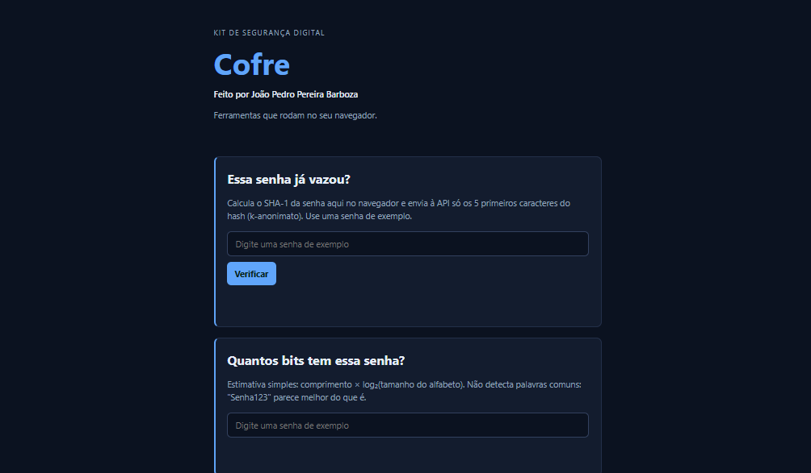

# Cofre: kit de segurança digital

**Veja funcionando:** https://joaopedropbarboza.github.io/cofre/

## O que é

O Cofre e um site com ferramentas para aprender sobre segurança de senhas.Ele consulta se uma senha de exemplo aparace em vazamentos e ele meio que estima ali a força de uma senha , a consulta envia a API somente o começo do hash; a senha fica no navegador

## Ferramentas

* **Essa senha já vazou?** Consulta uma base real de senhas vazadas sem enviar a senha (k-anonimato).
* **Quantos bits tem essa senha?** Estima a força da senha.
* Gerador de senhas: cria uma senha aleatória no navegador com o tamanho escolhido, entre 8 e 32 caracteres.

## O que eu aprendi

* Aprendi a preparar arquivos para um commit usando git add e a conferir as mudanças com o git status.
* vi que remover um arquivo não apaga o que já foi registrado no histórico do git.
* &#x20;Usei git revert para desfazer uma alteração com erro sem apagar o commit posterior do README

## Tecnologias

HTML, CSS, JavaScript, Git, GitHub Pages e a API Pwned Passwords.

## Sobre o histórico

O histórico tem um arquivo `.env` com uma senha falsa, de propósito: foi um exercício para mostrar que apagar um arquivo não apaga o que já foi publicado no Git.

## Créditos

Código-base do Prof. Mario Rebello, na disciplina Introdução à Ciência da Computação (2026/2).
A ferramenta Gerador de senhas. é de minha autoria. Licença MIT.

